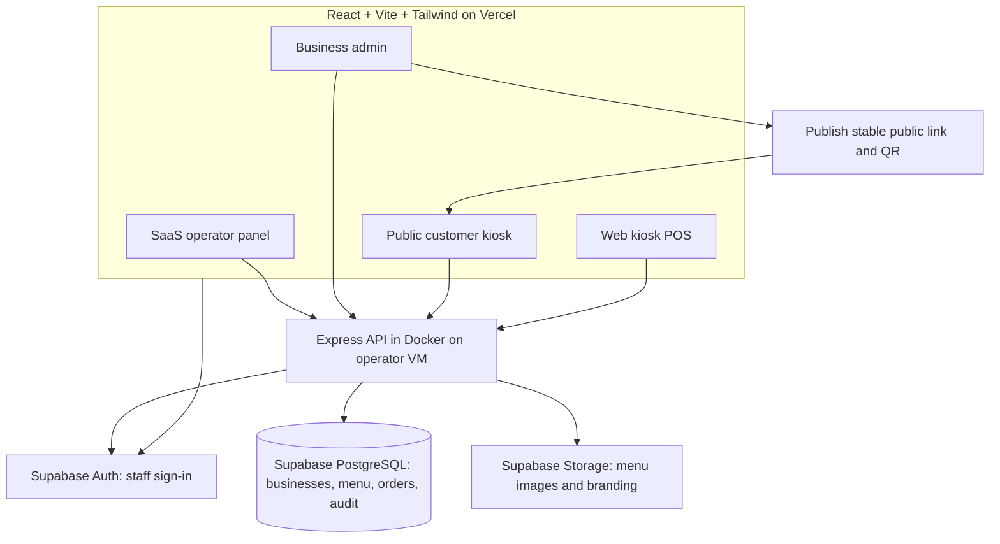
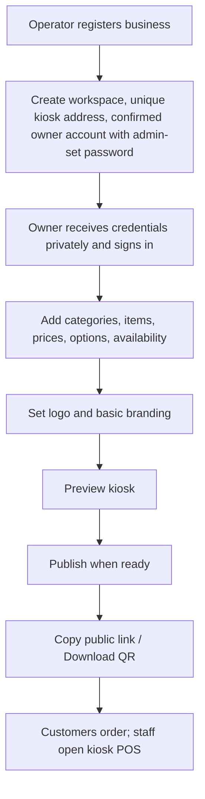
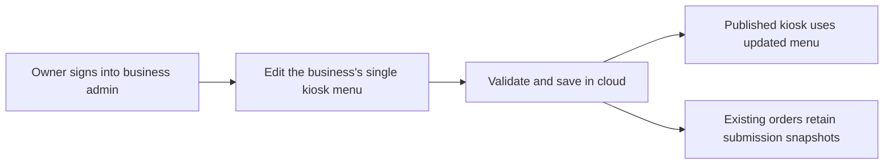
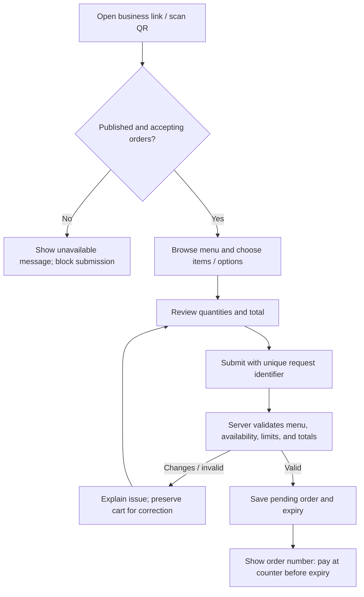
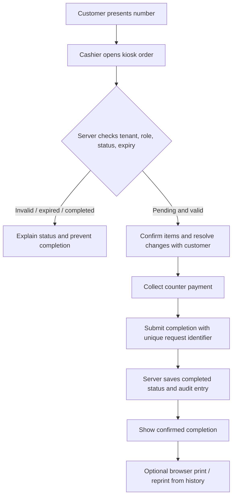

> Current UI: owner edits product cards and categories, previews identity/logo drafts, saves and publishes; customer chooses dine-in/takeout, browses optional-photo cards, submits a cart, receives four digits, and pays cash through owner POS. POS fetches only on explicit lookup/refresh. Supabase hosts optional images with a UI fallback.

> Current onboarding uses admin-set passwords and internally confirmed accounts, with no email verification. Customer checkout returns a four-digit number; the owner retrieves it in Kiosk POS and completes cash checkout. More advanced flows below are future product planning, not claims of implementation.

# Portable Kiosk — System and UI Flow

Status: Updated November 17, 2026. The simple first flow is implemented locally; README.md documents exact supported features.

Build sequence and phase acceptance checks: [IMPLEMENTATION_PLAN.md](IMPLEMENTATION_PLAN.md).

## One web platform, four surfaces

Each registered business gets its own public kiosk, business admin, and kiosk POS within one shared application. The SaaS operator manages registered businesses through a separate operator panel. The kiosk POS processes only orders submitted through the kiosk.



There is one cloud menu per business. The public kiosk displays it; submitted orders preserve their own item and price snapshots; the kiosk POS retrieves those orders. There is no installed app, local catalog, offline counter workflow, or separate application deployment per client.

Frontend deployment is on Vercel; the Express API is deployed separately in Docker on the operator's VM. Supabase provides PostgreSQL, Auth, and image storage. Protected API requests carry a Supabase access token, and Express enforces tenant and role permissions. Start with polling for the POS pending list.

## Who manages what?

| Person | Surface | Main tasks |
| --- | --- | --- |
| Platform operator | SaaS operator panel | Register businesses, provision owners, manage status, limits, and support |
| Owner / authorized manager | Business admin | Menu, branding, publish/pause, link/QR, hours, expiry, staff, and history |
| Cashier | Kiosk POS | Find kiosk orders, review, collect and record counter payment, complete, cancel where permitted |
| Customer | Public kiosk | Browse, select items, submit an unpaid order, receive and present its number |

All surfaces require internet and cloud reachability. Enforce business isolation and permissions on every server operation. Public kiosk access does not grant staff or admin access.

## Flow 1: register and launch a client



New businesses start unpublished. Provisioning reserves the public address automatically. The owner shares it through the admin rather than manually creating another website. Pausing ordering keeps the address and QR stable.

## Navigation

Business workspace:

```text
BUSINESS NAME

OPERATIONS
  Kiosk POS
  Order history

MANAGE — authorized roles only
  Kiosk menu
  Branding & preview
  Publish, link & QR
  Ordering hours & expiry
  Staff & permissions
  Business settings
```

Operator panel:

```text
PLATFORM
  Businesses
  Register business
  Owner accounts & invitations
  Service activity & errors
  Platform limits
  Support audit history
```

Cashier accounts see only permitted destinations. Operator access is restricted and audited.

## Flow 2: owner manages the kiosk



Menu screen: categories, search, item list, Add item, price, options, and availability. Branding screen: logo, colors, cover image, limited layout selection, and preview. Publishing screen: publish/unpublish, pause ordering, public link, Copy link, and Download QR.

Menu changes affect future submissions; they must not silently change pending order totals. The server validates the current menu when an order is submitted.

## Flow 3: customer submits a kiosk order



Customer screens: menu, item/options, cart, and confirmation. Confirmation displays the business name, number, items, total, expiry, and payment-due instruction. A submission does not initiate preparation or prove payment. Public confirmation access must not expose other orders.

Duplicate clicks and uncertain submission retries must reconcile the same request rather than create duplicate orders.

## Kiosk POS screen

```text
Cafe Maria / Kiosk POS                   Service: Connected
Kiosk orders only

[Enter order number...] [Find order]     [Refresh]
[Pending orders]

Order A142 • Pending • Expires at 2:45 PM
Coffee × 2                                   PHP 180.00
Total                                        PHP 180.00

[Mark completed]   [Cancel — if permitted]
```

There is no New counter sale action or independent product grid. Selecting a pending order or entering its number opens the same server-validated order. Lookup is scoped to the signed-in business.

Completion confirmation shows the order details and total and asks staff to confirm they handled payment at the counter. No separate payment-method form or payment ledger is required. The action marks the order completed; it does not collect or verify an electronic payment.

After server-confirmed completion, show Completed, optional Print summary, View order, and Back to pending orders. Printing and reprinting do not complete the order again.

## Flow 4: kiosk order completion



The platform is free for client businesses for now. There are no per-order fees, subscriptions, billing screens, or billable-usage records. Customers still pay the business at the counter. Unique constraints prevent two cashiers or retries from completing the same order twice.

Expired orders require a new customer kiosk submission. Completed records cannot be silently deleted; authorized reversals retain order history. Detailed payment accounting is outside the initial scope.

## Connectivity and failure states

| Situation | UI behavior |
| --- | --- |
| Cloud unreachable | Show Service unavailable; block submission, retrieval, and completion |
| Submission result uncertain | Preserve cart and request ID; reconcile before creating another order |
| Session expired | Ask staff to sign in again; preserve relevant request identifiers for reconciliation |
| Completion request times out | Show Checking completion status; reconcile the same request before another attempt |
| Payment collected, completion unresolved | Show unresolved payment/order state and staff recovery instructions; never request payment again automatically |
| Order already completed by another cashier | Show completed status and prevent a second completion/payment action |
| Order expired / cancelled | Explain status; disable payment/completion |
| Price or availability issue | Show the issue; require an authorized, server-validated resolution with customer agreement |
| Printer absent or print fails | Keep completed order saved; offer history and reprint |
| Kiosk unpublished, paused, closed, or suspended | Explain ordering availability; prevent new submissions |
| Business suspended | Block POS processing; owner history/export access follows the defined suspension policy |

Cached pages or orders do not enable offline checkout. Server confirmation is required before displaying completion success.

## History, reporting, and operational boundaries

Business history shows pending, completed, expired, cancelled, and reversed kiosk orders with appropriate access controls. Operator order reporting is scoped by business. No billing reports or separate payment records are included.

These reports cover kiosk activity only; they are not the merchant's complete business sales totals. Cloud backups and restore procedures protect authoritative records. Browser print summaries must not be represented as accredited invoices without validating that capability separately.

## Build sequence

1. Business data model, tenant isolation, roles, operator registration, and confirmed owner account with admin-set password.
2. Business admin, single menu, branding, preview/publish, link/QR, hours, and expiry.
3. Mobile customer kiosk, cart, server-validated submission, number, and expiry.
4. Web kiosk POS, pending list, lookup, completion confirmation, durable completion, and reconciliation.
5. Order history, audit, operator monitoring, backup/restore, and basic order reports.
6. Optional browser print layout after pilot device validation.

Outside the first release: Electron, local SQLite catalogs, offline operation, standalone walk-in checkout, external POS integrations, online payments, inventory, kitchen workflow, multiple branches, and unrestricted website customization.
